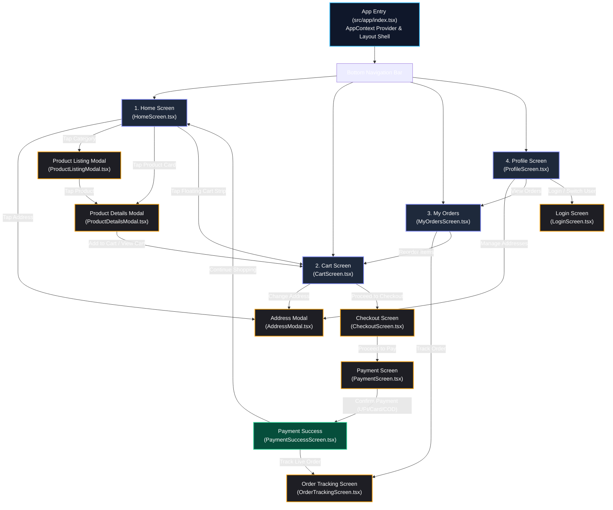
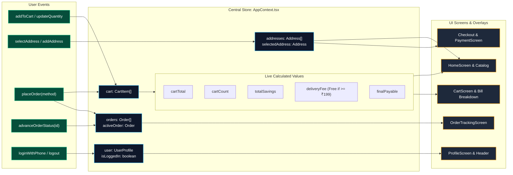

# QuickCart Application Flow Diagram

This document illustrates the end-to-end user journeys, screen navigation paths, modal transitions, and reactive data flow of the application.

---

## 1. High-Level Navigation & Screen Hierarchy



---

## 2. End-to-End User Purchase Lifecycle

```mermaid
sequenceDiagram
    autonumber
    actor User as Shopper
    participant Home as Home Screen
    participant Details as Product Details
    participant Store as AppContext
    participant Cart as Cart Screen
    participant Checkout as Checkout & Payment
    participant Tracking as Order Tracking

    User->>Home: Browse Catalog / Search Items
    User->>Details: Tap on Product (e.g., Organic Bananas)
    User->>Details: Click "Add to Cart"
    Details->>Store: addToCart(product, quantity)
    Store-->>Cart: Compute Subtotal, Discount & Free Delivery Threshold
    
    User->>Cart: Review Items & Check Bill Breakdown
    User->>Checkout: Click "Proceed to Checkout"
    Checkout->>Store: Fetch selectedAddress
    User->>Checkout: Choose Payment Method (UPI / Card / COD)
    User->>Checkout: Click "Confirm & Pay"
    
    Checkout->>Store: placeOrder(paymentMethod)
    Note over Store: 1. Generate Order ID (#FC-XXXXX)<br/>2. Assign Delivery Partner & ETA (35m)<br/>3. Clear Active Cart<br/>4. Append to orders[]
    Store-->>Checkout: Order Confirmed
    Checkout->>Tracking: Redirect to Live Order Tracking
    
    loop Status Simulation
        User->>Tracking: View Stepper: Placed → Confirmed → Preparing → Out for Delivery → Delivered
        Tracking->>Store: advanceOrderStatus(orderId)
    end
```

---

## 3. State & Event Data Flow Diagram


